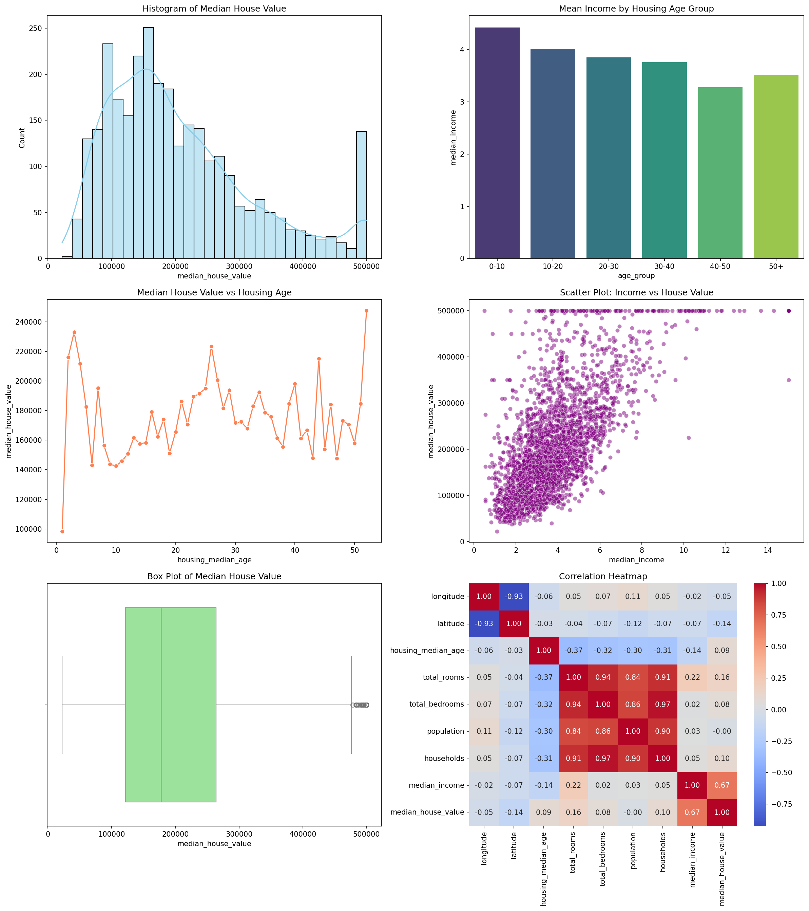

# Data Analysis Using Python

## Topic: NumPy, Pandas, Matplotlib, Plotly, EDA, and Feature Engineering

### Project Overview
This project performs a comprehensive data preprocessing, exploratory data analysis (EDA), data visualization, and feature engineering on the **California Housing Dataset**. It satisfies all requirements of the practical assignment curriculum.

---

## Step 1: Dataset Collection
- **Dataset Name:** California Housing Dataset
- **Source:** Kaggle / Google Colab Sample Data
- **Source URL:** [California Housing Dataset on Kaggle](https://www.kaggle.com/datasets/camnugent/california-housing-feature-engineering)
- **Problem Statement & Objectives:** Predict and understand patterns governing median house values in California based on demographics, location, and housing characteristics. The main objective is to preprocess the raw data, perform EDA, engineer new features, and prepare the dataset for predictive machine learning models.

---

## Step 2: Python and NumPy Operations
- Numerical columns (like `median_house_value` and `median_income`) were extracted into NumPy arrays for scientific computation.
- Key descriptive statistics calculated using NumPy:
  - **Mean:** $205,846.27
  - **Median:** $177,650.00
  - **Standard Deviation:** $113,100.83
  - **Minimum:** $22,500.00
  - **Maximum:** $500,001.00
  - **25th Percentile:** $121,200.00
  - **75th Percentile:** $263,975.00

---

## Step 3 & 4: Pandas Operations, Cleaning & Preprocessing
- **Data Structure:** 3,000 rows and 9 core columns.
- **Data Cleaning Summary:**
  - Checked for missing values: None found.
  - Checked for duplicate records: 0 duplicate rows detected.
  - Handled outliers and verified data type consistency across all features.

---

## Step 5: Exploratory Data Analysis (EDA)
### Top 5 Key Observations:
1. **Income is King:** A strong positive linear correlation (0.67) exists between `median_income` and `median_house_value`.
2. **Value Cap:** There is a significant data spike at exactly $500,001, indicating that housing values were capped during data collection.
3. **Geographical Clusters:** Highly populated areas with high house values are concentrated around specific latitude/longitude coordinates (coastal California).
4. **Age Factor:** Newer communities (age group 0-10) have residents with a higher mean income compared to mature neighborhoods (50+ years).
5. **Household Densities:** The density of rooms per household behaves stably across age groups, averaging around 5 rooms per household.

---

## Step 6 & 7: Visualizations & Analysis

### Exploratory Analysis Visualization Dashboard
Below is the generated analysis dashboard showing key statistics and correlations:



### Static Visualizations Summary:
- **Histogram:** Distribution of median house values showing a right-skewed profile with a $500k cap.
- **Bar Chart:** Average household income grouped by neighborhood age categories.
- **Line Chart:** Movement of median house values plotted against housing age.
- **Scatter Plot:** Visual relationship showing house prices rising alongside median income.
- **Box Plot:** Summary of median house values identifying mild outliers on the upper bounds.
- **Correlation Heatmap:** Matrix demonstrating positive dependencies between income, rooms, and house values.

### Interactive Plotly Visualizations:
- **Interactive Histogram:** Explorable distributions of housing values.
- **Interactive Scatter Plot:** Income vs. House Value with interactive hover metadata (such as population).
- **Interactive Bar Chart:** Exploring average room count per household across age groups.

---

## Step 8: Feature Engineering
Three new features were engineered to improve downstream predictive model accuracy:
1. **Rooms per Household (`rooms_per_household`):** Captures average home sizes.
2. **Bedrooms per Room Ratio (`bedrooms_per_room`):** Indicates home density/crowdedness.
3. **Population per Household (`population_per_household`):** Measures average family size.

*Numerical scaling was successfully applied using `StandardScaler` to uniformize the range of engineered features and income metrics.*

---

## Step 9: Analysis, Limitations & Conclusion
- **Conclusion:** Location and household income are the strongest predictors of housing prices in California.
- **Limitations:** The dataset lacks real-time economic indicators (interest rates, school district ratings, inflation metrics) and has capped target values ($500,001), which limits the model's accuracy on premium real estate.

---

## Step 10: How to Run the Project
1. Clone this repository:
   ```bash
   git clone <your-repository-url>
   ```
2. Install the dependencies:
   ```bash
   pip install -r requirements.txt
   ```
3. Run the Jupyter Notebook to explore the code and interactive plots.
